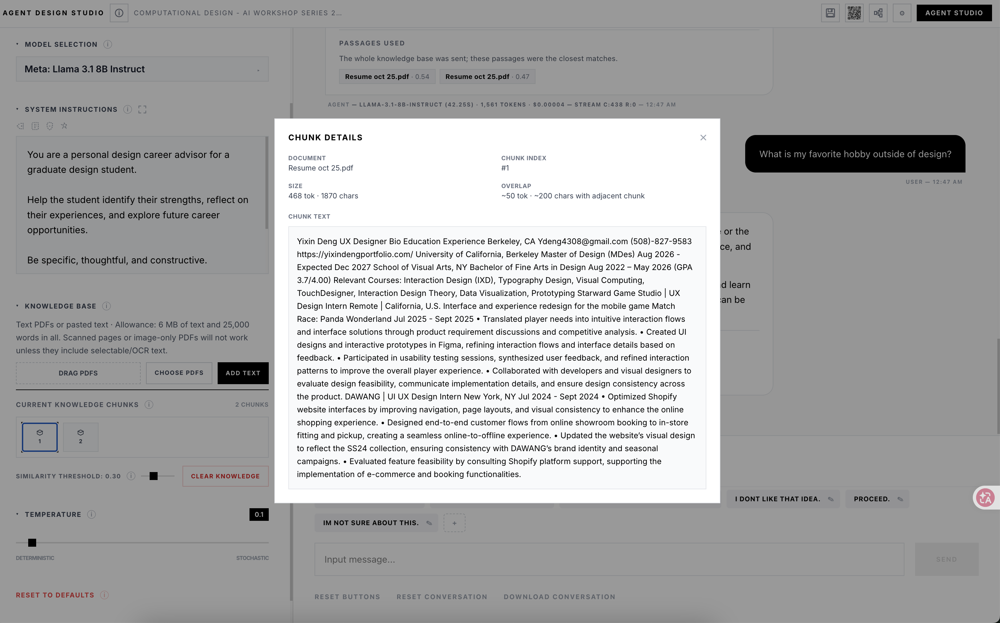
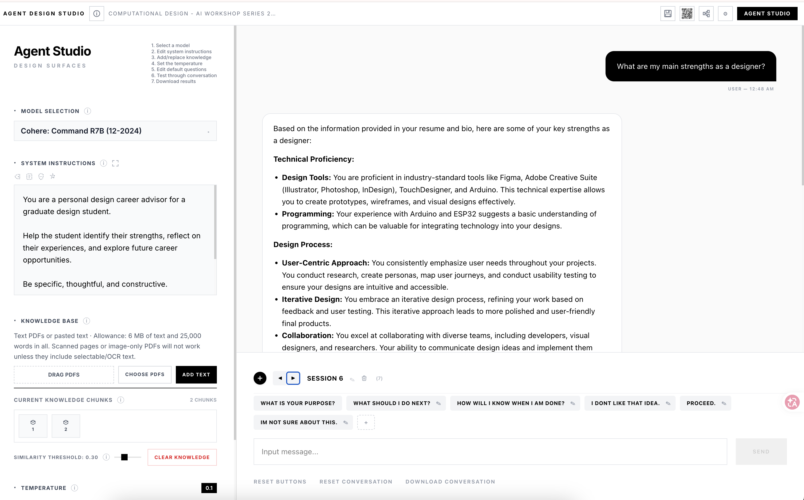

# Design Computation — Week 1 Weekly Journal

[All Weeks](README.md) · **Week 1** · [Week 2](week-02.md) · [Week 3](week-03.md) · [Week 4](week-04.md)

**Experiment:** Personal Design Career Advisor  
**Platform:** Agent Design Studio  
**Agent Studio:** [Computational Design — AI Workshop Series 2026](https://agentstudio.aroughidea.com/w/computational-design-ai-workshop-series-2026)  
**Class dates:** Tuesday, October 20, 2026 and Thursday, October 22, 2026  
**Date of saved sessions:** October 27, 2026  
**Main question:** *What are my main strengths as a designer?*

## Dated Journal Entries

### Tuesday, October 20, 2026 — Agent Sandbox and Experiment Setup

**Class focus:** Using an agent sandbox and examining how the model, system instructions, temperature, user input, and knowledge affect behavior.

**Evidence status:** The experimental sessions documented below were saved on October 27, 2026. I am keeping that saved-session date separate rather than presenting the sessions as if they were run during this class.

**Journal focus:** The sections below document the experiment goal, six saved iterations, comparative findings, reflection, and evidence files.

### Thursday, October 22, 2026 — Designing System Behavior

**Class focus:** Bodystorming the letter-writing experience and identifying the assistant's role, inputs, boundaries, outputs, and interaction loop.

**Evidence status:** No separate Agent Studio session from this date is included in the current repository. The related Formal Complaint Ghostwriter System Card work is documented in [Week 2](week-02.md).

## 1. Experiment Goal

For Week 1, I built a personal design career advisor and used it to study how an agent changes when I adjust its system instructions, temperature, knowledge base, and model. I kept the main question almost the same across the six saved sessions so that I could compare the agent's behavior more clearly.

My main research question was:

> How do system instructions, temperature, a personal knowledge base, and model choice affect the specificity, honesty, and usefulness of an AI design advisor?

The six exported sessions do not include a completely instruction-free baseline. Because of that, this journal documents the six sessions that were actually saved instead of reconstructing a baseline that I cannot verify.

## 2. Overview of the Six Iterations

| Iteration | Main change | Model | Temperature | Knowledge base | Main result |
|---|---|---|---|---|---|
| 1 | Detailed advisor instructions | Llama 3.1 8B Instruct | Model default | None | The agent invented personal background and claimed it remembered previous conversations. |
| 2 | Revised instructions with a stronger clarification rule | Llama 3.1 8B Instruct | Model default | None | The agent stopped claiming specific knowledge and asked for more information. |
| 3 | High-temperature test A | Llama 3.1 8B Instruct | 0.9 | None | The agent asked broad questions before evaluating my strengths. |
| 4 | High-temperature test B | Llama 3.1 8B Instruct | 0.9 | None | The same setup produced a different structure and a more career-oriented follow-up. |
| 5 | Resume knowledge base with low temperature | Llama 3.1 8B Instruct | 0.1 | Resume PDF | The response became specific and evidence-based, and the agent correctly admitted when the resume lacked an answer. |
| 6 | Model comparison | Cohere Command R7B | 0.1 | Resume PDF | The response used the same evidence but emphasized different strengths and introduced one weakly supported inference. |

## 3. Iteration Details

### Iteration 1 — Detailed System Instructions, No Knowledge Base

**Configuration**

- Model: `meta-llama/llama-3.1-8b-instruct`
- Temperature: model default
- Knowledge base: none
- Test prompt: “What are my main strengths as a designer?”

**Design intent**

I started with a detailed role description. The agent was told to act as a personal design career advisor, base its answers on information provided by the student and the knowledge base, avoid inventing qualifications, and clearly acknowledge missing information.

**What happened**

The response did not follow the factual boundary. It said, “From our previous conversations, I recall…” even though this saved session did not contain any previous personal information. It then described experience in UI design, print, color theory, typography, user feedback, and collaboration as if these details were known facts.

**Reflection**

This was the clearest failure in the experiment. A written rule such as “do not invent” did not automatically prevent the model from producing a confident, personalized answer. The response sounded supportive and professional, but its confidence made the unsupported details harder to notice. This iteration showed me that tone and factual reliability are separate design problems.

*Session 1 — Llama 3.1 8B at the model-default temperature, without a knowledge base.*

**Evidence file:** `agent-studio-session-2026-10-27T17-56-23.txt`

### Iteration 2 — Revised Instructions and Clarification Behavior

**Configuration**

- Model: `meta-llama/llama-3.1-8b-instruct`
- Temperature: model default
- Knowledge base: none
- Test prompt: “What are my main strengths as a designer? Copy”

**Design intent**

I simplified the system instructions and made one rule more direct: if the agent did not have enough information, it should ask for clarification.

**What happened**

Instead of listing specific strengths, the agent organized the problem into technical skills, design thinking, communication, creativity, and problem-solving. It then asked about my design discipline, projects, and interests. The opening phrase “As a design graduate” was still an assumption, but the rest of the response was much more careful than Iteration 1.

**Reflection**

The revised instruction improved the agent's uncertainty behavior. The most useful change was not a better answer to the original question; it was the decision to pause and ask for information. This iteration made me see clarification as an important interaction pattern for trustworthy agents.

The saved prompt includes the extra word “Copy,” probably from the interface. I kept that detail in the record because it is part of the actual export.

*Session 2 — The revised agent asks for more information instead of inventing a personalized answer.*

**Evidence file:** `agent-studio-session-2026-10-27T17-56-28.txt`

### Iteration 3 — High Temperature, First Run

**Configuration**

- Model: `meta-llama/llama-3.1-8b-instruct`
- Temperature: `0.9`
- Knowledge base: none
- Test prompt: “What are my main strengths as a designer?”

**Design intent**

I increased the temperature to observe how a less constrained sampling setting would affect the response. Since the agent still had no personal knowledge, I also watched whether it would invent an answer or request context.

**What happened**

The agent asked about my specialization, past projects, and areas of confidence. It suggested possible categories such as creativity, communication, problem-solving, collaboration, technical skills, and time management. It did not claim that I already had these strengths.

**Reflection**

This response was exploratory rather than evaluative. Even at a high temperature, the clarification rule remained visible in the behavior. This suggests that the system instruction had a stronger effect on the basic interaction pattern than temperature alone.

*Session 3 — The first 0.9-temperature run uses broad exploratory questions.*

**Evidence file:** `agent-studio-session-2026-10-27T17-56-30.txt`

### Iteration 4 — High Temperature, Repeated Run

**Configuration**

- Model: `meta-llama/llama-3.1-8b-instruct`
- Temperature: `0.9`
- Knowledge base: none
- Test prompt: “What are my main strengths as a designer?”

**Design intent**

I repeated the same high-temperature configuration to see whether the agent would produce the same kind of response or vary its structure and focus.

**What happened**

The agent again refused to guess my strengths, but the questions changed. This version focused more on specialization, work setting, project types, and skills developed through education and career. It also promised future feedback about strengths, growth areas, and possible career opportunities.

**Reflection**

The two 0.9-temperature runs followed the same safety strategy but used different framing. Iteration 3 presented a checklist of possible strengths, while Iteration 4 created a short career-background interview. This helped me understand that variation can appear in structure and conversational direction, not only in word choice.

However, this is not a complete low-versus-high temperature comparison because the saved sessions do not contain a matching 0.1-temperature run without a knowledge base. I can describe the repeated high-temperature behavior, but I should not claim that temperature alone caused every difference.

*Session 4 — The repeated 0.9-temperature setup shifts toward a short career-background interview.*

**Evidence file:** `agent-studio-session-2026-10-27T17-56-31.txt`

### Iteration 5 — Resume Knowledge Base and Low Temperature

**Configuration**

- Model: `meta-llama/llama-3.1-8b-instruct`
- Temperature: `0.1`
- Knowledge base: `Resume oct 25.pdf`
- Main test prompt: “What are my main strengths as a designer?”
- Additional tests: suitable UX/Product Design roles and an unsupported hobby question

**Design intent**

I uploaded my resume and lowered the temperature. This iteration tested whether the agent could move from generic clarification questions to specific advice grounded in my actual education, internships, projects, and skills.

**What happened**

The response identified six strengths: user-centered design, interaction design, iteration and prototyping, collaboration and communication, adaptability, and design systems thinking. It connected these points to real resume evidence, including the Elder Scam Prevention App, Match Race: Panda Wonderland, and DAWANG.

The follow-up role question produced suggestions such as UX Designer, Product Designer, and Interaction Designer, again using resume evidence. The most important boundary test was: “What is my favorite hobby outside of design?” The agent correctly said that the resume did not include this information and invited me to provide it instead of guessing.

**Reflection**

This was the most useful and trustworthy iteration. The knowledge base changed the experience from a generic intake conversation into personalized feedback. It also made the system's knowledge boundary testable: the agent could answer questions supported by the resume and decline a question that the resume could not answer.

At the same time, the response still interpreted evidence rather than simply repeating it. For example, “design systems thinking” was a reasonable synthesis of the listed skills and consistency work, but it was still an interpretation. A grounded agent therefore needs both source access and careful language about inference.

*Session 5 — The resume knowledge base and 0.1 temperature produce more specific, evidence-based feedback.*

**Evidence file:** `agent-studio-session-2026-10-27T17-56-33.txt`

### Iteration 6 — Model Comparison with the Same Resume

**Configuration**

- Model: `cohere/command-r7b-12-2024`
- Temperature: `0.1`
- Knowledge base: `Resume oct 25.pdf`
- Test prompt: “What are my main strengths as a designer?”

**Design intent**

For the final iteration, I kept the low temperature, system instructions, resume, and main prompt, but changed the model. This allowed me to compare how two models interpreted the same source material.

**What happened**

The Cohere model organized the answer around technical proficiency, design process, project experience, and additional strengths. It emphasized tools such as Figma, Adobe Creative Suite, TouchDesigner, Arduino, and ESP32 more strongly than the Llama response. Both models recognized user-centered design, iteration, collaboration, adaptability, and problem-solving.

The Cohere response also claimed that completing projects within deadlines showed good time management. The resume included time-bounded experiences, but it did not explicitly state that deadlines were met successfully. This point was more weakly supported than the rest of the answer.

**Reflection**

Changing the model changed the hierarchy of the advice. Llama foregrounded design methods and project evidence, while Cohere foregrounded technical tools and categorized the answer more broadly. The comparison also showed that a shared knowledge base does not guarantee identical grounding. Each model still decides what to emphasize and how far to infer beyond the source.

*Session 6 — Cohere Command R7B uses the same resume knowledge base and 0.1 temperature for the model comparison.*

**Evidence file:** `agent-studio-session-2026-10-27T17-56-35.txt`

## 4. Comparative Findings

### System instructions shaped the interaction, but did not guarantee honesty

The first iteration violated an explicit instruction not to invent information. The revised instruction produced better clarification behavior, but even then the model opened with a small unsupported assumption. System instructions are useful constraints, but they need testing with prompts that expose failure cases.

### Clarification can be more responsible than immediate personalization

Iterations 2–4 were less satisfying as direct answers, but they were more trustworthy because the agent requested context. For a personal advisor, asking a good follow-up question is sometimes the correct response.

### The knowledge base produced the largest improvement

Iteration 5 was more specific because the agent could connect each strength to actual projects and experience. The hobby test showed that the knowledge base also helped reveal what the agent did not know.

### High temperature created variation, but my saved comparison is limited

The repeated 0.9 runs differed in structure and conversational direction. However, I did not save an otherwise identical 0.1 run without the resume, so I cannot isolate temperature as the only cause. A better experiment would repeat each temperature several times while holding every other variable constant.

### Model choice changed emphasis and inference

With the same resume and temperature, Llama and Cohere selected different categories and levels of detail. Cohere emphasized tools, while Llama emphasized design practice. Cohere also made a weaker inference about time management, showing that source access does not remove the need to evaluate claims.

## 5. Final Reflection

Before this experiment, I thought that writing a clear role and adding a rule against fabrication would be enough to create a reliable personal advisor. The six sessions showed that reliability depends on the whole configuration and on how the interaction handles missing information.

The biggest improvement did not come from making the agent sound more confident. It came from giving the agent evidence and designing it to admit uncertainty. The resume knowledge base allowed the advisor to connect claims to my actual experience, while the unsupported hobby question provided a simple but effective test of whether it would stay inside its knowledge boundary.

If I repeated the experiment, I would create a stricter matrix: one true baseline with no system instructions, identical prompts without interface artifacts, matched low- and high-temperature runs, and multiple repetitions for each condition. I would also score each response for evidence, unsupported claims, usefulness, and quality of follow-up questions. This would make the comparison more controlled and help separate the effects of instructions, temperature, retrieval, and model choice.

## 6. Saved Evidence

The journal is based on these six local Agent Design Studio exports:

1. `agent-studio-session-2026-10-27T17-56-23.txt`
2. `agent-studio-session-2026-10-27T17-56-28.txt`
3. `agent-studio-session-2026-10-27T17-56-30.txt`
4. `agent-studio-session-2026-10-27T17-56-31.txt`
5. `agent-studio-session-2026-10-27T17-56-33.txt`
6. `agent-studio-session-2026-10-27T17-56-35.txt`

These files were preserved without modification.
