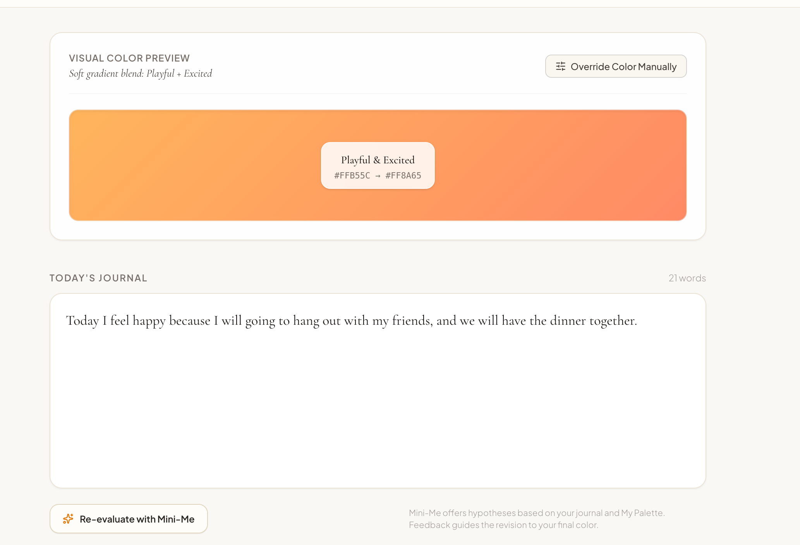
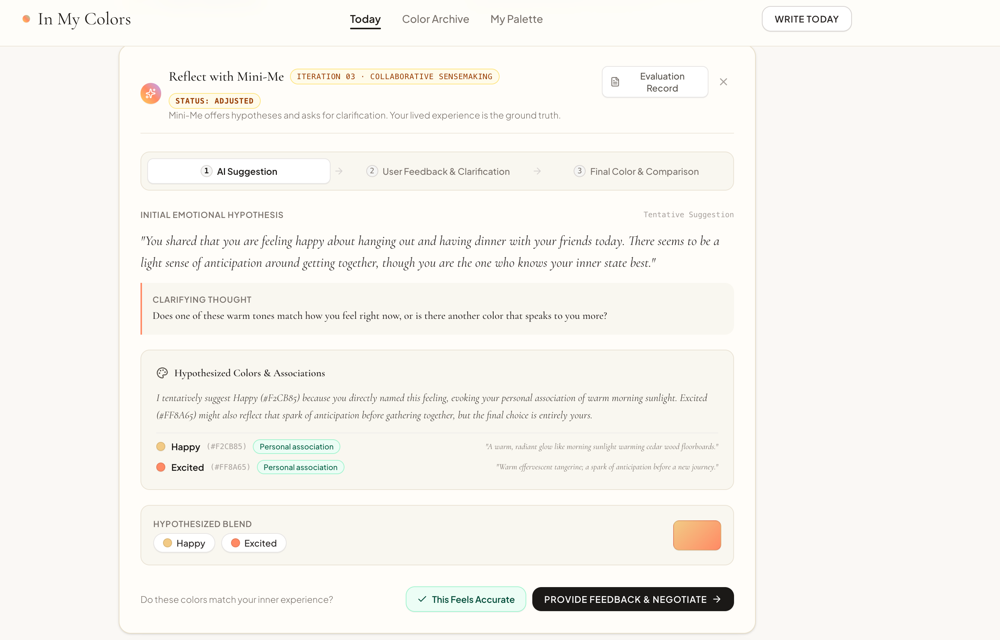
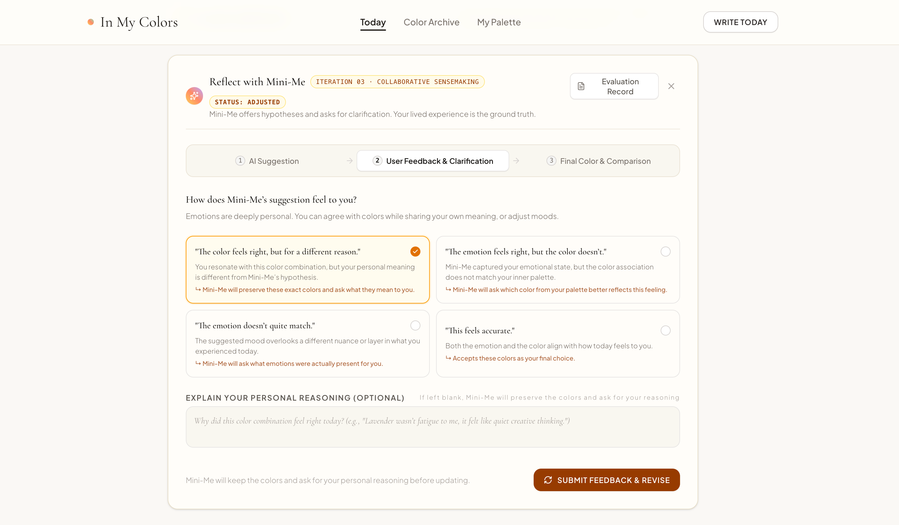
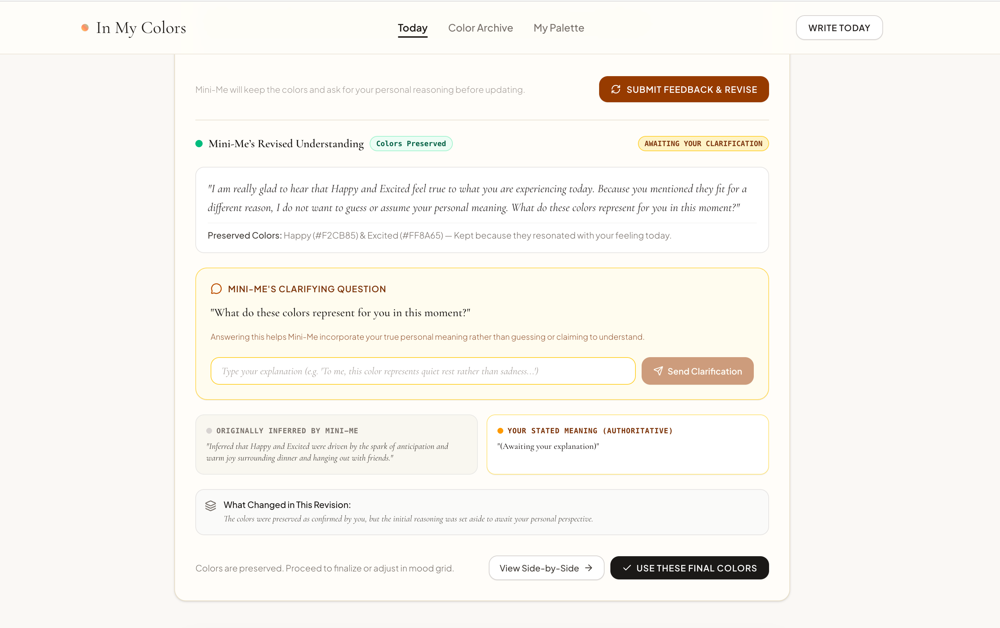
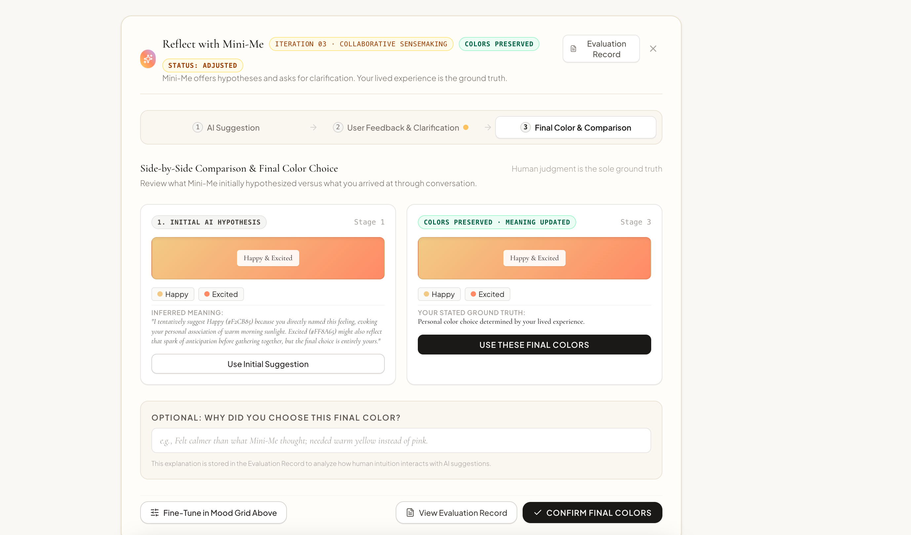
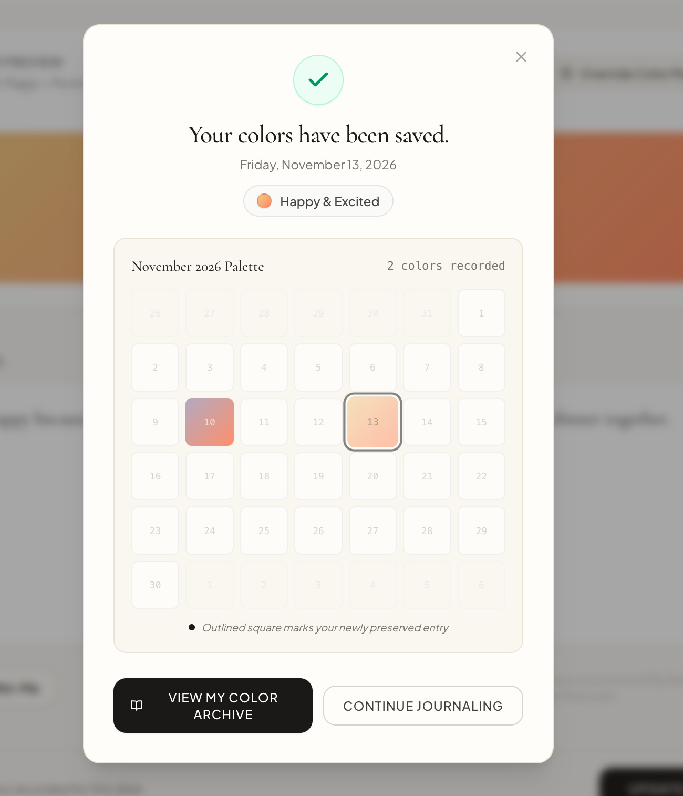

# Design Computation — Week 4 Weekly Journal

[All Weeks](README.md) · [Week 1](week-01.md) · [Week 2](week-02.md) · [Week 3](week-03.md) · **Week 4**

- **Class meetings:** Tuesday, November 10 and Thursday, November 12, 2026
- **Follow-up deployment check:** Friday, November 13, 2026
- **Systems:** FormalFlow / GhostWriter and Mini-me / In My Colors

> **Evidence boundary:** The observations below come from recorded Google AI Studio and deployed-app tests. Failed runs remain labeled as failures. The Mini-me screenshots show one continuous interaction from journal input to a human-approved archive entry; they are not six separate experiments.

## Tuesday, November 10 — FormalFlow Baseline and Repair

### Initial runtime failure

The generated letter-writing UI loaded, but the first test produced non-JSON HTML and the error `Unexpected token '<'`. Another attempt displayed `Could not generate the letter right now`. I recorded these as failed runtime tests rather than claiming the app was working.

### Successful generation

After repairing the runtime path, the same workload complaint produced a complete editable formal letter. Unknown names, dates, course details, and addresses appeared as bracketed placeholders rather than fabricated facts.

### Iteration 1 — Missing-fact check

I asked AI Studio to identify important missing facts before drafting. The revised interface added questions for:

- course title, code, and instructor;
- assignment names and conflicting dates;
- recipient information;
- requested resolution.

The user could answer or select **Skip & Use Placeholders**. This translated the System Card’s factual boundary into a visible interaction.

### Iteration 2 — Confirmation before drafting

The next version added an editable summary with three sections:

1. Situation
2. Impact
3. Requested Resolution

The summary was labeled **Pending Your Confirmation (Not Yet Verified)**. A letter was generated only after the user confirmed or corrected it.

## Thursday, November 12 — Revision and Evaluation

### Iteration 3 — Ambiguous revision request

I tested:

> Make the letter stronger, but do not make it aggressive.

Instead of silently overwriting the draft, the app produced two editable alternatives:

- **Option A — Constructive & Collaborative**
- **Option B — Firm & Evidence-Based**

The interface explained their different tone and emphasis. The user could select either version or choose **Keep Current Draft**.

### Peer feedback

> The three-step flow was easy to understand, and the clarification questions and visible placeholders made missing information clear. However, the generated letter expanded the original complaint with stronger claims about an “unmanageable burden,” “high academic standards,” and effects on “the student body.” The agent should avoid broadening the user’s experience beyond confirmed information.

This feedback revealed a problem beyond invented names or dates: an agent can keep factual fields accurate while still amplifying the user’s impact claim. The next System Instruction should require every impact statement to come from the confirmed summary or be marked as a suggestion.

### Deployment test

The first Vercel deployment loaded the frontend but returned `Request error (404)` when Generate Letter was pressed. After repairing the production API route and environment configuration, the public version generated an editable placeholder-based letter from the intentionally incomplete prompt `Write a complain letter`.

- **Public app:** [ghostwriter-sqhi.vercel.app](https://ghostwriter-sqhi.vercel.app/)
- **Source:** [yi470/GhostWriter](https://github.com/yi470/GhostWriter)
- **AI Studio:** [FormalFlow](https://ai.studio/apps/1c2e08ac-00d5-4350-bde1-aa7a9918171e)
- **Environment variable name:** `GEMINI_API_KEY` (the secret value is never documented)

## Different Design Goal — Mini-me / In My Colors

Mini-me applies the same principle of human control to a different task. It treats AI output as a hypothesis about mood and color, then asks the user to negotiate or replace that interpretation.

The following screenshots are one complete recorded flow.

### 1. Journal entry and color preview

The user wrote about feeling happy before meeting friends. The interface displayed a warm **Playful + Excited** preview and still allowed manual color override.

### 2. Initial AI suggestion

Mini-me proposed **Happy `#F2CB85` + Excited `#FF8A65`** and clearly labeled the response as a tentative suggestion. The user remained able to accept it or provide feedback.

### 3. User feedback

The user selected **“The color feels right, but for a different reason.”** This separated agreement with the colors from agreement with the AI’s interpretation.

### 4. Revised understanding

Mini-me preserved the colors, stopped claiming to know their meaning, and asked what they represented to the user. The status showed that the system was awaiting human clarification.

### 5. Final comparison

The side-by-side screen separated the **Initial AI Hypothesis** from **Colors Preserved · Meaning Updated**. This is important evidence that the AI revision and final human decision were not treated as the same stage.

### 6. Human-approved archive entry

The final **Happy & Excited** colors were saved only after explicit confirmation. The archive marked the November 13 entry and preserved the user-approved result.

### Classmate feedback on Mini-me

A classmate said that the current color-selection options felt limited and that she wanted more colors to choose from. This suggests that the feedback loop supports interpretation well, but the final manual choice should offer a broader palette or custom color picker.

## System Maps

The two editable maps use the same legend:

- **H — Human judgment:** facts, meaning, confirmation, and final choice.
- **D — Deterministic operation:** interface state, validation, API routing, saving, and export.
- **P — Probabilistic output:** Gemini clarification, interpretation, summary, and drafting.

- [GhostWriter Detailed System Map](https://www.figma.com/board/lCqKByHlpduLcwGlkoVqRB/TDF-Weekly-Journal?node-id=215-361)
- [Mini-me Detailed System Map](https://www.figma.com/board/lCqKByHlpduLcwGlkoVqRB/TDF-Weekly-Journal?node-id=164-83)

## Comparison

| System | Design problem | Main human-control mechanism | Remaining issue |
|---|---|---|---|
| FormalFlow | Turn incomplete notes into an accurate formal complaint | Clarification, placeholders, summary confirmation, editable revision options | Gemini can amplify impact beyond confirmed information |
| Mini-me | Explore personally meaningful colors | Feedback categories, clarification, manual override, explicit save | The available color-selection range feels limited |

## Reflection

The strongest improvement in both systems was turning abstract behavioral rules into visible checkpoints. FormalFlow made uncertainty visible through questions, placeholders, and confirmation. Mini-me separated an AI hypothesis from the user’s personal meaning and final saved color.

The main lesson is that human control is not just an instruction such as “the user decides.” It must appear in the interface as opportunities to correct, decline, compare, override, and confirm. The remaining problems are also specific: FormalFlow needs stronger factual guardrails for impact language, while Mini-me needs a wider range of final color choices.

## Current Links

- [FormalFlow public app](https://ghostwriter-sqhi.vercel.app/)
- [GhostWriter GitHub](https://github.com/yi470/GhostWriter)
- [Mini-me public app](https://mini-me-yz1f.vercel.app/)
- [Mini-me Google AI Studio project](https://ai.studio/apps/a8285912-3f8b-40f7-b62d-f04003a04b67)
- [Weekly Journal FigJam](https://www.figma.com/board/lCqKByHlpduLcwGlkoVqRB/TDF-Weekly-Journal?node-id=215-361)

